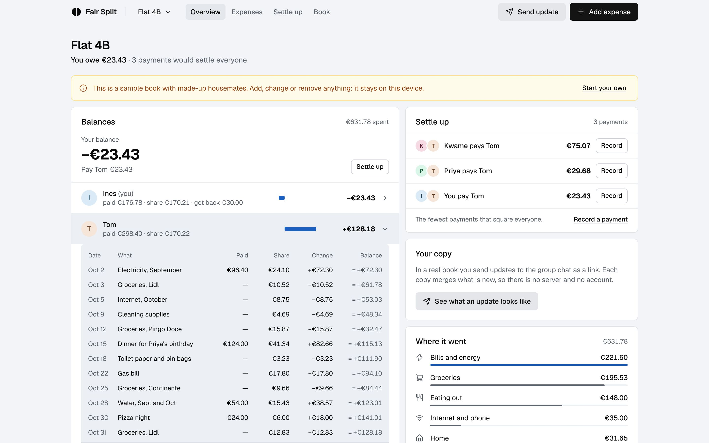
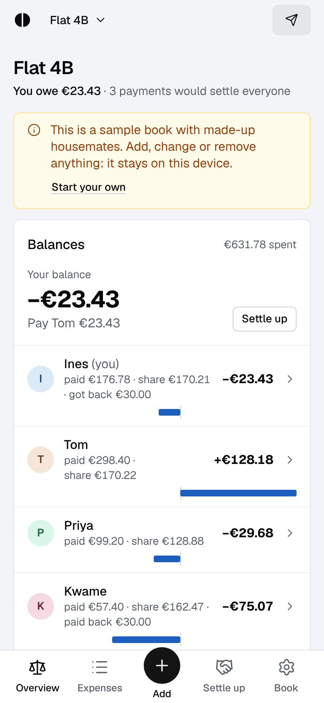
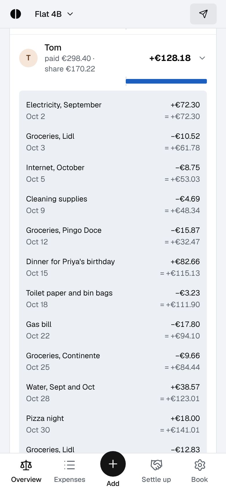
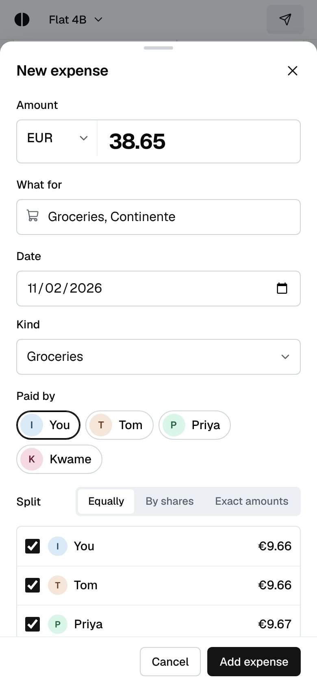
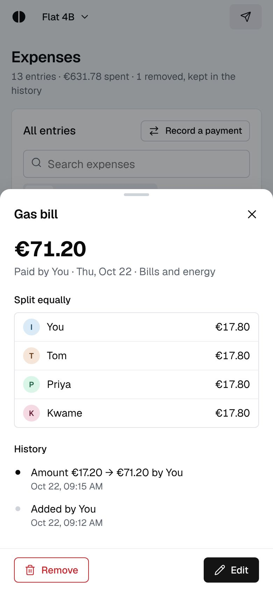
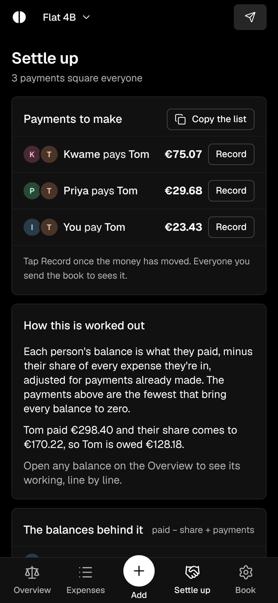
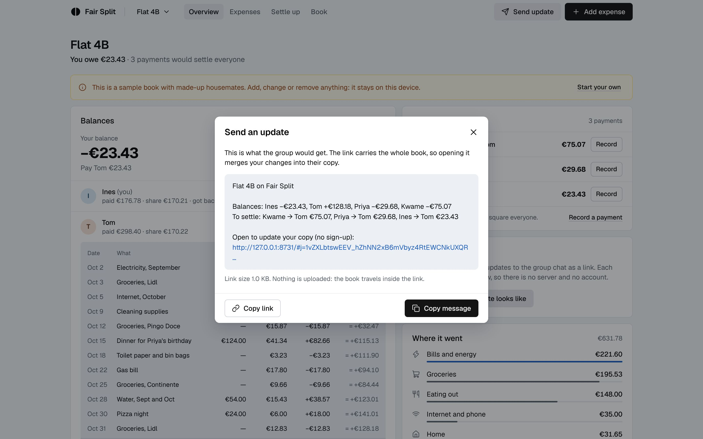

# Day 1: Fair Split

**Date:** 2 November 2026 (replaces [Round Book](../archive/day-01-round-book/))
**Platform:** Web (installable PWA, works offline)
**Live:** https://bassambeelal.github.io/10-apps-10-days/day-01-fair-split/app/
**Sample book:** add `#/sample` to the address to open a filled-in flat of four housemates.



## The problem

- **Who has it:** housemates and trip groups who share costs over weeks or months.
- **What it costs them:** nobody can see how a balance was reached, and anyone can change old entries, so someone rebuilds it all in a spreadsheet. Then the free tier runs out mid-trip and the whole group has to move apps.
- **Proof it's real:**
  - Splitwise reviewers left because they didn't trust the balances and checked them in Excel ([Trustpilot](https://www.trustpilot.com/review/splitwise.com), October 2025). Another was hit by the daily limit and the ads, and moved the house to Tricount (March 2025). Others say any member can edit or delete entries by accident (April 2026), or that a subscription prompt came after a few expenses (July 2026).
  - Re-checked on 2 November 2026: April 2026 reviews still complain about the free cap of three expenses a day and the 10-second countdown before each one.
  - Tricount reviewers found wrong balances after checking them in a spreadsheet, and say it can't be used without the app ([Trustpilot](https://www.trustpilot.com/review/tricount.com), May and July 2026).
- **The best free alternative:** Spliit is free and open source with no account, but every change goes through its server and needs a connection. Fair Split's edge is trust and ownership:
  - every balance shows its working
  - nothing is changed silently
  - the book never touches a server

## What it does

- **Books:** one per flat, trip or group, each with its own currency and people. You can keep several and switch between them from the top bar.
- **Add an expense in one sheet:**
  - the amount, what it was for and the date
  - who paid
  - how to split it: equally between chosen people, by shares (Kwame was away, so he pays one share and everyone else two), or by exact amounts
  - the kind of expense is guessed from the words and can be changed
  - sums such as `12.50+3.20` work, and so do amounts typed with a comma or a dot
- **Spending in another currency:** pick its currency and the rate your bank used, and the book counts the converted amount. The original amount stays on the entry.
- **Every balance shows its working:** tap anyone on the Overview and their balance opens into a ledger, one line per expense or payment. Each line shows the date, what paid, share, change and running balance. It ends on the balance with the sum written out: paid − share + paid back − got back.
- **Nothing changes behind your back:**
  - a correction is a new version of the entry, so the history shows "Amount €17.20 → €71.20 by Ines, 22 Oct 09:15"
  - a removed entry stays in the list struck through, with who removed it, and can be restored
  - someone already in an entry can be renamed but not removed
- **Settle up with the fewest payments:**
  - it finds the smallest number of transfers that squares everyone, exactly, for groups of up to 16 people with a balance
  - beside the list is the table of balances it came from, and a worked example from the book's own numbers
  - "Record" logs a payment once the money has moved, and "Copy the list" gives the payments as text for the chat
- **The group chat carries the updates:**
  - "Send update" writes a message with what's new, everyone's balance and who pays whom, then a link to the book
  - opening the link merges your changes into their copy, and they send theirs back the same way
  - a banner says what an update brought ("Updated from Ana's copy: 1 new entry, 1 correction") and highlights those entries
- **Your copy:** the top bar shows how many of your changes the group hasn't seen yet, and the Overview says when you last sent the book and whose update arrived last.
- **Joining:** someone who opens a link for a book they don't have picks which person they are, after seeing who is in it and the balances.
- **Backup files:** save the book as a file, or open one, for email or a shared drive.
- **Also:**
  - dark mode, which follows the device or can be set
  - installs as an app, and declares itself a share target, so on Android a shared message should open straight in the installed app (not yet tried on a device)
  - works offline after the first visit
  - press N to add an expense on a keyboard

## What it doesn't do (on purpose)

- **No server and no live sync.** The book lives on each person's device, and the link is how copies meet. That's the whole point: no account, no daily limit, and no company holding the group's money history. The cost is that someone has to send an update after adding things; the app counts unsent changes so that's hard to forget.
- **It never moves money.** It's a record and a calculator.
- **No receipt photos.** They would make the link too large to share in a message.

## How sharing works

- **The log:**
  - a book is an append-only log of events: the book's name, each person, and each version of each entry
  - nothing is overwritten, and the balances, the working and the settle-up list are all computed from the log
  - money is kept in whole cents (or whatever the currency's smallest unit is), and split by largest remainder, so shares always add up to the total
  - the odd cent rotates between people from one entry to the next
- **The link:**
  - the whole log is packed, compressed with the browser's `CompressionStream` and put after `#j=`
  - that part of a link is never sent to any server, GitHub Pages included
  - the sample book's link is about 1 KB, and a busy flat's year of entries stays well within what chat apps carry
- **Merging:**
  - merging two copies takes every event from both, so it gives the same result in any order, and merging twice changes nothing
  - if two people correct the same entry, the later correction wins and both stay in the history
- **Safety:** everything that arrives from a link or a file is checked field by field before use, and nothing from a book is ever treated as HTML.

## Run it

- **Open it:** open `app/index.html` in a browser, straight from the folder, or serve the `app/` folder with any static server.
- **Run the tests:**

```bash
node --test day-01-fair-split/test/
```

## What was tested

- **Unit tests:** 10 tests on the core, run with `node --test`, all passing. They cover:
  - splits that always add up, with the odd cent moving between people
  - the shares and exact modes
  - settle-up against a brute-force minimum on 300 random books, plus the case where greedy pairing needs one payment too many
  - the sample book's balances and working
  - copies merging in either order
  - the link round trip, including a link cut in half
  - checks that reject bad events
  - amounts typed in different styles
  - category guessing
- **In a real browser (Chromium through Playwright):**
  - the whole flow at 390 px and 1440 px, light and dark: create a book, add three expenses (equal, by shares, and in pounds by exact amounts), open the working and send an update
  - opening the link in a fresh browser, joining as Ana, adding an expense and sending it back
  - the first browser merges it and shows "Updated from Ana's copy: 1 new entry"
  - a broken link shows a clear error
  - no console errors in any run
- **Offline and from a file:**
  - offline: with the service worker installed, a reload with the network off still opens the book in the right font
  - opening `index.html` from the file system works
- **The design skill's checks:**
  - lint: 0 FAIL and 2 WARN. One is padding in the ISO date builder. The other is the em dash used as the missing-value mark, which the app rules call for.
  - inspector, in app mode at 1440, 768 and 390 px: 0 FAIL on every screen
  - the Overview, Book settings, Welcome and New book screens show 0 WARN
  - Settle up warns that the bottom third of a desktop screen is empty: the screen is short and ends there
  - Expenses warns that the list runs longer than its summary rail: it's a full list beside a sticky rail

## Design

- **The style:** from the **design-taste-frontend** skill's app run, *achromatic-ledger* (seed 1156612432).
  - no colour in the chrome; money is set in ink
  - the primary action is near-black
  - one blue (#1d5fbf) on the main data element: the balance bars
- **The face:** a blue-grey ledger ground.
- **The signature element:** every balance opens into its working, like a receipt.
- **The type:** Geist, bundled with the app so it works offline. Icons are from Lucide.
- **Every state is designed:**
  - first run, an empty book, a merged update and a sample book
  - a removed entry, a corrected entry, a bad link, a missing book and a full device
  - the phone tab bar, and Android's back button closing a sheet

## Screens

| | |
|---|---|
|  |  |
|  |  |
|  |  |

## Files

```
app/index.html            the page
app/core.js               the log, splits, balances, working, settle-up, merging, the link (no DOM; tested in Node)
app/app.js                the interface
app/app.css               the style
app/sample.js             the sample book, built with the same functions
app/icons.js              Lucide icons used (ISC licence)
app/fonts/                Geist (SIL Open Font Licence)
app/sw.js, manifest       offline and install
test/core.test.js         the tests
```
