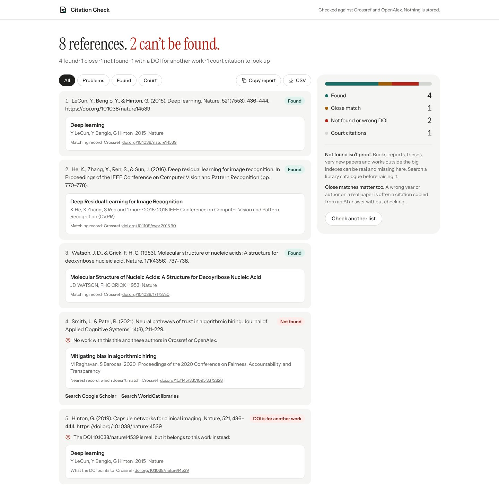

# Day 3: Citation Check

**Date:** 2 November 2026 (replaces [Lender Check](../archive/day-03-lender-check/))
**Platform:** Web (installable PWA)
**Live:** https://bassambeelal.github.io/10-apps-10-days/day-03-citation-check/app/
**Demo video:** [a one-minute narrated tour](media/demo.mp4), recorded from the running app (how it's made: [demo-video](../demo-video/)).



## The problem

- **Who has it:**
  - students, librarians and teachers marking reference lists
  - peer reviewers
  - people representing themselves in court, and the courts reading their filings
- **What it costs them:**
  - AI tools invent references that look exactly like real ones: plausible authors, a real journal, sometimes a real DOI attached to the wrong paper
  - checking a list of 40 by hand takes an afternoon
  - in court, lawyers and litigants have been sanctioned for citing cases that don't exist
- **Proof it's real:**
  - [Damien Charlotin's database of court decisions involving AI-made citations](https://www.damiencharlotin.com/hallucinations/)
  - [Scientific American on requests for imaginary journals](https://www.scientificamerican.com/article/ai-slop-is-spurring-record-requests-for-imaginary-journals/)
  - [GPTZero on invented citations in NeurIPS papers](https://gptzero.me/news/neurips/)

## What it does

- **Paste a list in any style:**
  - APA, Harvard, MLA, Chicago, Vancouver, IEEE, or BibTeX
  - numbered, one per line, or separated by blank lines
  - lines that wrap are joined back together
  - the count of references found updates as you paste
- **Each reference is looked up:**
  - **With a DOI:** Crossref is asked for that DOI.
    - If the DOI exists, the work it points to is compared with the title, authors and year as written.
    - A real DOI attached to a different work is a strong sign of an invented reference, so it gets its own result.
  - **Without a DOI, or a DOI no one has registered:** Crossref's bibliographic search runs on the whole reference, then OpenAlex's search if Crossref finds no exact match.
  - **The results:**
    - **Found:** the title, first author and year all match.
    - **Close match:** the work exists but a detail differs, spelled out ("You wrote 2017; the record says 2015").
    - **Not found:** with the nearest record if there is one, and links to search Google Scholar and WorldCat libraries.
    - **DOI is for another work:** shows what the DOI really points to.
- **Court citations:**
  - recognised from the reporter ("925 F.3d 1339", "678 F. Supp. 3d 443", "347 U.S. 483", and common UK forms)
  - each one links to CourtListener's citation page, so a real case opens and a made-up one finds nothing
- **The verdict leads:**
  - the heading is the list's one fact ("8 references. 2 can't be found.")
  - a summary shows the counts
  - a filter shows only the problems
- **Exports:** copy a plain-text report or download a CSV.
- **Also:** dark mode, and it installs as an app. The app itself loads offline; lookups need a connection, and the page says so when there isn't one.

## Being fair about "not found"

- Every screen says that "not found" means not in Crossref or OpenAlex, which isn't proof that a work doesn't exist.
- Books, reports, theses, very new papers and works outside the big indexes can be real and missing.
- The links to search Scholar and library catalogues are there for that.

## What leaves the page

- Each reference's text is sent to Crossref and OpenAlex to search them. Nothing is stored by the app.
- Court citations are only links: nothing is sent to CourtListener unless you click.

## How it's built

- **The stack:** plain HTML, CSS and JavaScript with no build step.
- **The core:** `cite-core.js` holds the splitting, DOI and court-citation extraction, record shapes and matching, and has no DOM or network, so it's tested in Node.
- **Matching:** the share of the record's title words found in the reference, plus the first author's surname and the year. Close matches say exactly what differs.
- **Politeness:** two references are checked at a time, with retries that respect "slow down" (429) answers.

## Run it

- **Open it:** serve the `app/` folder with any static server.
- **Run the tests** (the Node tests, then the browser test against the app served on port 8733):

```bash
node --test day-03-citation-check/test/core.test.js
```

```bash
node day-03-citation-check/test/e2e.js /tmp/out
```

## What was tested

- **Node tests:** 5 tests, all passing. They cover:
  - splitting numbered, bracketed, blank-line, wrapped-line and BibTeX lists
  - DOIs, including ones with brackets such as Lancet DOIs
  - court citations and their CourtListener links
  - found, close and not-found matching
  - OpenAlex records
- **In Chromium, with fixture responses:** the sample list of eight references at 1440 and 390 px, light and dark, with no page errors.
  - **This build machine can't reach Crossref or OpenAlex:** its network policy blocks them. So the test answers those requests from fixtures written in the services' documented response formats (`message.items` for Crossref, `results` for OpenAlex).
  - **The results:** the three real papers were found. The invented paper was not found. The invented title with a real DOI was caught as a DOI for another work. The wrong year was a close match. The book was found through OpenAlex. The court case got its link.
  - **Offline:** with the network cut, it says "Couldn't check" rather than "Not found".
- **Not yet checked:** the calls to the live Crossref and OpenAlex services from a real browser. Opening the live page and pressing "Try a sample list" settles it in a minute. If either service refuses browser requests, the app shows "Couldn't check" rather than a false "Not found".
- **The design skill's checks:**
  - lint: 0 FAIL, 0 WARN
  - inspector, on the start screen at 1440, 768 and 390 px: 0 FAIL and 2 WARN, both from the dealt style: its 48px serif heading, and its centred 1,100px column

## Design

- **The style:** the design skill's *editorial-greeting* app style. The verdict is set as the heading in Instrument Serif, in a centred column, with tonal panels.
- **The colours:** teal for what checks out, red kept for the reference that fails.
- **The fonts:** Instrument Sans and Instrument Serif, bundled.
