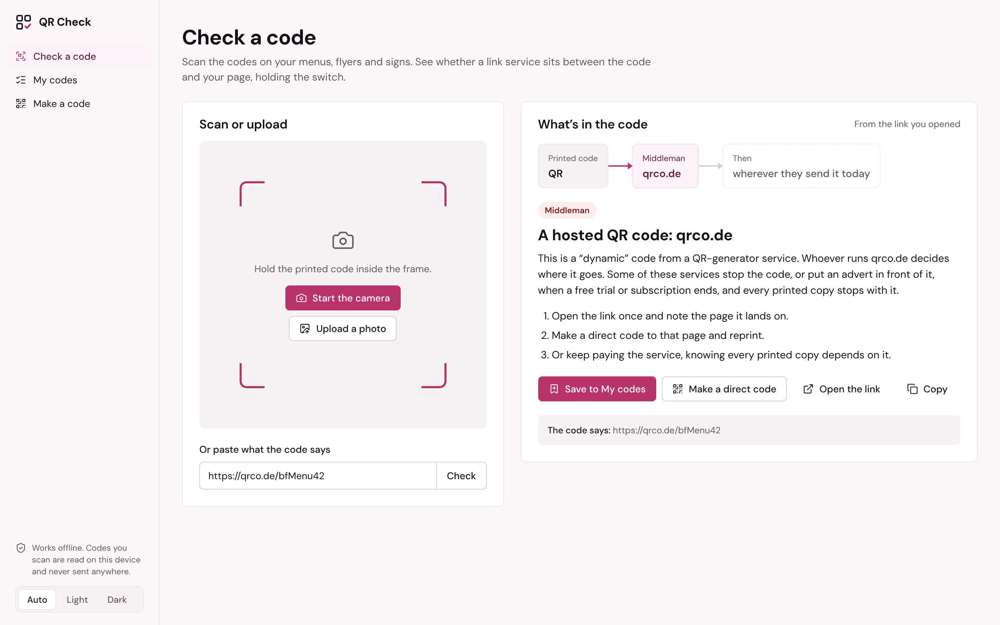

# Day 7: QR Check

**Platform:** Web (installable PWA, works offline)
**Live:** https://bassambeelal.github.io/10-apps-10-days/day-07-qr-check/app/
**Demo video:** [a one-minute narrated tour](media/demo.mp4), recorded from the running app (how it's made: [demo-video](../demo-video/)).
**Links straight in:** `?q=https://bit.ly/x` checks a code's text at once, and `?make=https://yourshop.com` fills the code maker.



## The problem

- **Who has it:** small businesses with QR codes printed on menus, table tents, flyers, signs and packaging.
- **What it costs them:**
  - many "free" QR generators make a *dynamic* code, which points at the generator's server, and that server sends people on
  - when a trial ends, or the service changes its rules, the code shows an advert or stops, and every printed copy fails with it
  - owners often don't know their code has a middleman at all
- **Proof it's real:** [Trustpilot reviews of Bitly](https://uk.trustpilot.com/review/bitly.com). More in `research/raw-candidates.md`.

## What it does

The app has three places: **Check a code**, **My codes** and **Make a code**.

- **Check a code:**
  - scan with the camera inside the app (with a frame and, where the phone has one, a light), upload a photo, or paste what the code says
  - **the chain** shows the printed code, then any middleman, then the destination, with the middleman marked, because that's who holds the switch
  - **the verdict:**
    - **Direct:** goes straight to your site, and nobody else can redirect it.
    - **Hosted QR code:** a QR-generator service sits in between (qrco.de, l.ead.me and others; anything with "qr" in the address is flagged as probably one).
    - **Short link:** bit.ly, tinyurl and others.
    - **Ad-gated:** customers see adverts first.
    - **Link page:** linktr.ee and similar, a middleman you control.
    - **Also recognised:** WhatsApp chats, Wi-Fi details, phone, email and contact codes, and **payment codes** (the EMV standard behind Pix, UPI's Bharat QR, NQR, PayNow and others). For a payment code it reads out the merchant name and city, and flags a code whose checksum doesn't match.
  - **See where it goes:**
    - a web page isn't allowed to follow another site's redirects, but Bitly, TinyURL and is.gd each publish a preview page that names a link's destination without sending you there
    - QR Check opens that page for those services, and for others it tells you to open the link once
- **My codes:**
  - save each checked code with where it's printed ("Table tents", "Menu, front page")
  - the list puts the codes that depend on a middleman first, under "Replace these first", and downloads as a spreadsheet
  - when the list is empty, it offers the places codes usually hide (menus, table tents, flyers, packaging, the window), and picking one fills in the label when you save
- **Make a code:**
  - a website, WhatsApp chat, Wi-Fi network, email, phone number or text
  - words under the code, and two strengths: standard (still scans with 15% damaged) or extra strong (30%)
  - every code is **read back** as soon as it's drawn, to prove it says exactly what you typed
  - download a print-ready PNG or an SVG, or print an A4 sheet of 12 stickers
  - it warns if you paste a middleman link, and gives short advice before printing a hundred (size for the scanning distance, keep the white border, test a proof)
- **Also:** dark mode, works offline, installs as an app.

## How it's built

- **The stack:** plain HTML, CSS and JavaScript with no build step.
  - `qr-core.js` holds all the logic and has no DOM, so it's tested in Node.
  - [jsQR 1.4.0](https://github.com/cozmo/jsQR) reads codes when the browser has no built-in `BarcodeDetector`.
  - [qrcode-generator 1.4.4](https://github.com/kazuhikoarase/qrcode-generator) makes them.
  - Both libraries and the DM Sans font are bundled.
- **Text is encoded as UTF-8**, so a code in any language scans back as written. The first build used the library's default, Latin-1, which garbled anything outside Western European letters.

## Run it

- **Open it:** serve the `app/` folder (the camera needs `https` or `localhost`).
- **Run the tests:**

```bash
node --test day-07-qr-check/test/core.test.js
```

## What was tested

- **Unit tests:** 6 tests, all passing. They cover:
  - middlemen, preview pages, non-link codes, and payment codes with good and bad checksums
  - building each kind of code
  - **every kind of code the app makes, drawn and decoded back to exactly the same text**, at both strengths, including Arabic and Chinese text
- **In a real browser (Chromium):**
  - **The full loop:** made a code, downloaded the PNG, uploaded it on the Check screen. It read back as "Goes straight to lumencafe.pt", and saving it put it in My codes.
  - **The camera:** fed a video of that code, the camera found it and showed the result.
  - **The other paths:** the Wi-Fi and website self-checks, the middleman warning, the places shortcut filling in the label, and an offline reload after the first visit.
  - **Screens:** checked at 1440 and 390 px, light and dark, with no page errors.
- **The design skill's checks:**
  - lint: 0 FAIL, 0 WARN
  - inspector, in app mode: Check and Make show 0 FAIL and 0 WARN
  - an empty My codes list warns that the lower screen is empty below its checklist

## Limits

- **Middlemen without a preview page:** for those, it can't show where the code sends people today without opening the link. It says so and links to it.
- **The list of middlemen is hand-made** (about 35 services). Anything with "qr" in the address is flagged as probably a QR service.

## Design

- **The style:** the design skill's *accent-ladder* app style: one raspberry on small marks, its pale tints on areas.
- **The face:** a ground tinted toward that raspberry.
- **The signature element:** the chain.
- **The shell:** a sidebar with three places, which becomes a tab bar on phones.
