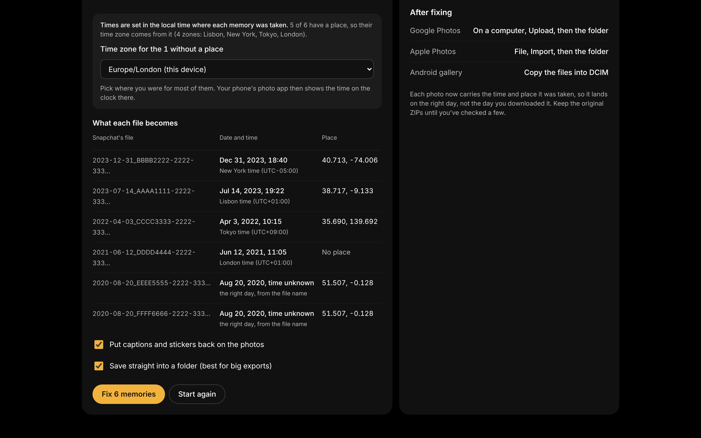

# Day 9: Memories Fixer

**Platform:** Web (installable PWA, works offline once loaded)
**Live:** https://bassambeelal.github.io/10-apps-10-days/day-09-memories-fixer/app/
**Demo video:** [a one-minute narrated tour](media/demo.mp4), recorded from the running app (how it's made: [demo-video](../demo-video/)).
**Run it:** serve the `app/` folder and open it in Chrome or Edge, which can save straight into a folder. Any modern browser works, with a ZIP download instead.

## The problem

- **Who has it:** anyone downloading their Snapchat Memories, which matters more now that free Memories storage is capped.
- **What it costs them:** every photo and video comes out dated "today", with no place, and captions or stickers in separate files. Years of memories land in the wrong spot in Google Photos. People pay for tools to fix it, and some inspect the tool's network traffic first, because the export is private.
- **Proof it's real:** [TechCrunch](https://techcrunch.com/2025/10/03/snapchat-is-planning-to-charge-for-storage-heres-how-to-save-your-memories-for-free), [Trustpilot: fixmyexport](https://at.trustpilot.com/review/fixmyexport.com).

## What it does

- Drop every ZIP from Snapchat's "My Data" email at once. The page streams through them in two passes, so a large export never sits in memory whole:
  - **Pass 1** lists the memories and reads `memories_history.json` (dates, places, download links).
  - **Pass 2** fixes each file and writes it out.
- **Photos:** writes `DateTimeOriginal`, its UTC offset (`OffsetTimeOriginal`) and GPS into the JPEG's EXIF.
- **The local time where it was taken:** Snapchat stores every time in UTC. Each memory with a place gets the time zone of the nearest of 7,260 cities, so a New Year's Eve photo in New York is dated 31 December at 18:40, whatever zone the computer is in. Memories with no place use a zone you pick (this device's zone by default).
- **A preview before anything is written:** "What each file becomes" lists the newest memories with their new date, time, zone and place.
- **Captions and stickers:** merges each overlay back onto its photo (optional). For videos, the overlay is saved next to the video with the same date.
- **Videos:** sets the creation time inside the MP4 (`mvhd`, `tkhd`, `mdhd`), which is what Google Photos reads.
- **File names:** start with the date and time (`2021-06-12_19-22-05_AAAA1111.jpg`), so files sort correctly anywhere.
- **Where it saves:** Chrome and Edge save straight into a folder you pick. Other browsers get one ZIP whose entries also carry the date.
- **Before it starts:** a summary of photos, videos, captions to merge, memories per year, and how many get an exact time or a place.

## How matching works

- **Exact:** the file's id appears in a history entry's download link, or it's the only memory of its kind that day.
- **Day only:** several memories share the day, so the file is dated at noon on the right day. A place is added only if every candidate that day shares it.
- **Missing JSON:** dates come from the file names alone, and the app says so.

## Privacy

- **Nothing is uploaded.** Everything runs in the page, with two small pinned libraries in `app/vendor/`: [fflate 0.8.2](https://github.com/101arrowz/fflate) (ZIP) and [piexifjs 1.0.6](https://github.com/hMatoba/piexifjs) (EXIF).
- **Bundled data and font:** the time-zone table (`tz-cities.js`) is built from [city-timezones](https://github.com/kevinroberts/city-timezones) (MIT), which uses Natural Earth's public-domain list of populated places. The Inter font is bundled too, so it works with Wi-Fi off after the first load.

## Tested (rebuild, 2 November 2026)

- **Engine tests:** `node --test day-09-memories-fixer/test/fix.test.js` runs 5 tests, all passing. They cover:
  - the right zone from a place for nine cities on six continents
  - wall clock and offset across summer time, including India's half-hour offset
  - EXIF times, offsets and GPS read back
  - matching
  - MP4 creation time
- **End to end in Chromium:** `test/e2e.mjs` drops a made-up two-ZIP export (from `test/make_export.py`) into the app, with the browser set to Los Angeles time. It fixes the export to a ZIP, and `test/check_output.py` reads every file back:
  - Lisbon: 19:22 +01:00, with the caption merged
  - New York: 31 December, 18:40, −05:00
  - Tokyo video: creation time exactly 01:15:30 UTC
  - no place: the chosen zone, Berlin, and no GPS
  - London, two photos on one day: the right day and the shared place
  - the chat image: left out
- **A larger export:** the same run then fixes a made-up 143-memory export in two ZIPs (from `demo-video/fixtures/make-memories.py`): 117 photos and 26 videos dated, 21 captions merged, 143 files out. This caught a real bug: the first streaming reader could wait for ever when a file crossed a chunk boundary, which any real export would hit. It's fixed (see the log).
- **Offline:** the first build's service worker never installed, because its file list held fragments of a broken icon file. It's rewritten, along with the icon.
- **Inspector:** the start screen shows 0 FAIL. One WARN, for the space around the drop zone's prompt inside its dashed box.

## Tested (first build)

An end-to-end run in the browser on a made-up export: a ZIP with `memories_history.json`, three JPEGs (one with a caption overlay), one MP4 and one chat image that isn't a memory.

- **Photo matched by its link:** exact time (converted to local time), the right GPS (6.52441, 3.37921 written as 6°31'27.88"), and the overlay merged.
- **Video:** creation time set to exactly 2022-12-25 09:10 UTC. Its 0,0 location was correctly ignored.
- **Two photos on the same day:** both got the day and the place they share, without a made-up time.
- **The chat image** was left out.
- **Inspector:** 0 FAIL, plus one WARN for empty space below the start screen's two cards (the end of a one-step page).

## Limits

- **Snapchat's export format changes now and then.** The file-name pattern and JSON fields are matched loosely, but a new format may need an update. Test with a real export before filming.
- **Time zones come from the nearest city.** Near a border, the nearest city can be in the next zone over. Memories with no place all use the one zone you pick.
- **Merged captions mean a re-saved JPEG** (quality 92%). Untick the option to keep the originals untouched.
- **ZIP output builds the file in the browser.** For multi-gigabyte exports, use the folder option in Chrome or Edge on a computer.

## Design

- **design-taste-frontend**, app-screen rules: the *true-black-flat* style (seed 101686840), now with a light version for devices set to light.
- **Its look:** one warm amber on the data instead of the dealt lime, on a true black background for media.
- **Its signature element:** the years strip, one bar per year of memories found.
